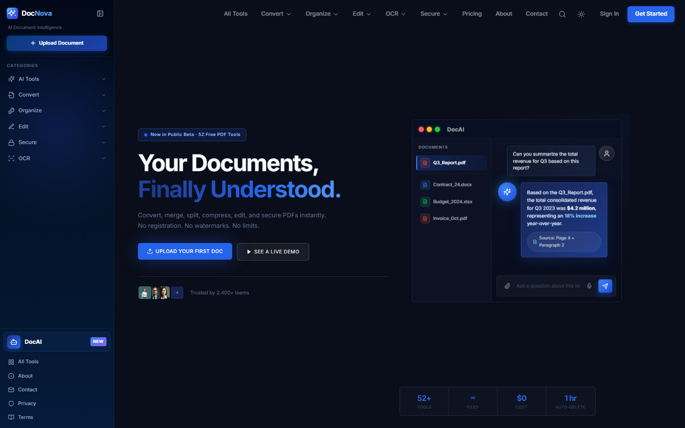
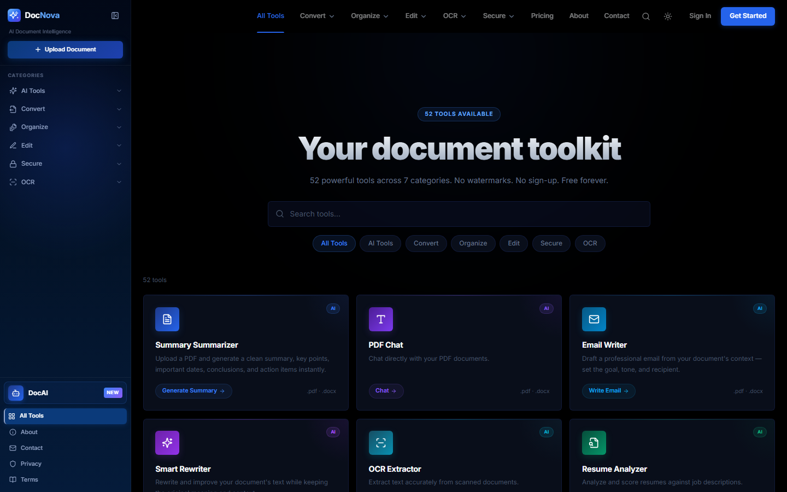

<div align="center">


# DocNova

**Your documents, finally understood.**

52 free PDF tools and an AI assistant that summarizes, explains and chats with your documents.<br>
No sign-up. No watermarks. No limits.

<br>

<a href="https://www.docnova.in"></a>
<a href="https://github.com/VenomDevX/DocNova-PDF-Tools/stargazers"></a>
<a href="LICENSE"></a>

<br>


<br><br>

<a href="https://www.docnova.in"></a>

</div>

<br>

## Why DocNova?

Most PDF sites cap your files, stamp watermarks or ask for an account. DocNova does not.

| | |
| :-- | :-- |
| 🧰 **52 tools, one place** | Convert, organize, edit, secure and OCR without switching sites |
| 🤖 **AI that reads for you** | Summaries, PDF chat, quizzes, flashcards, mind maps and contract review, powered by Gemini |
| 🔒 **Private by default** | No database. Uploads are temporary and wiped automatically after processing |
| ⚡ **Fast and free** | React + Vite frontend, lightweight Flask backend, $0 to use |

<br>

## Tools

<p align="center">
  
</p>

<details>
<summary><b>🤖 AI Tools</b> · 14</summary>
<br>
Summarizer · PDF Chat · Email Writer · Smart Rewriter · OCR Extractor · Resume Analyzer · Quiz Generator · Flashcards · Translator · Table Extractor · Contract Review · Document Categorizer · Mind Maps · Study Assistant
</details>

<details>
<summary><b>🔄 Convert</b> · 11</summary>
<br>
PDF ⇄ Word · PDF ⇄ Excel · PDF ⇄ PowerPoint · PDF ⇄ JPG · PNG to PDF · PDF to Images · Image to PDF
</details>

<details>
<summary><b>🗂️ Organize</b> · 9</summary>
<br>
Merge · Split · Rotate · Delete Pages · Reorder Pages · Extract Pages · Insert Pages · Resize · Compress
</details>

<details>
<summary><b>✏️ Edit</b> · 10</summary>
<br>
Edit PDF · Annotate · Add Text · Add Image · Highlight · Draw · Crop · Redact · Watermark · Page Numbers
</details>

<details>
<summary><b>🔐 Secure</b> · 6</summary>
<br>
Lock · Unlock · Protect · Remove Password · Encrypt · Decrypt
</details>

<details>
<summary><b>🔍 OCR</b> · 2</summary>
<br>
PDF OCR · Image OCR
</details>

<br>

## Run it locally

**You need:** Node.js 18+, Python 3.8+ and a free [Gemini API key](https://aistudio.google.com/apikey).

```bash
git clone https://github.com/VenomDevX/DocNova-PDF-Tools.git
cd DocNova-PDF-Tools
```

**Backend** (terminal 1)

```bash
cd backend
python -m venv venv
venv\Scripts\activate          # macOS/Linux: source venv/bin/activate
pip install -r requirements.txt
echo GEMINI_API_KEY=your_key_here > .env
python app.py
```

**Frontend** (terminal 2, project root)

```bash
npm install
npm run dev
```

Open **http://localhost:5173**. For more detail see [`START_HERE.md`](START_HERE.md) and [`BACKEND_SETUP.md`](BACKEND_SETUP.md).

<br>

## Tech stack

| Layer | Built with |
| :-- | :-- |
| Frontend | React 18 · TypeScript · Vite · Tailwind CSS · Lucide icons |
| Backend | Python · Flask · Gunicorn |
| Documents | PyMuPDF · PyPDF2 · pdf2image · python-docx · openpyxl · ReportLab |
| AI | Google Gemini (`google-genai`) |
| Hosting | Vercel (frontend) · Render (backend) |

<br>

## Security

- **Rate limiting** with Flask-Limiter against abuse and bot spam
- **Input validation** with Pydantic schemas and `bleach` sanitization
- **Upload hardening** with magic-byte checks (`python-magic`) to block spoofed files
- **Stateless processing** with no database; files use random UUIDs and are purged after use

<br>

## Contributing

Found a bug or want a new tool? [Open an issue](https://github.com/VenomDevX/DocNova-PDF-Tools/issues) or send a pull request. All contributions are welcome.

## License

[MIT](LICENSE) © Parth Sharma

<br>

<div align="center">

**If DocNova saved you time, please give it a ⭐. It helps other people find it.**

<a href="https://github.com/VenomDevX/DocNova-PDF-Tools/stargazers"></a>

</div>
